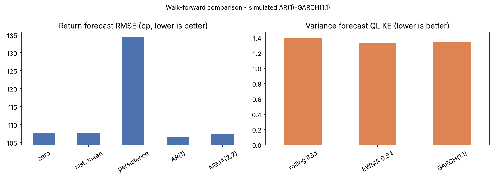
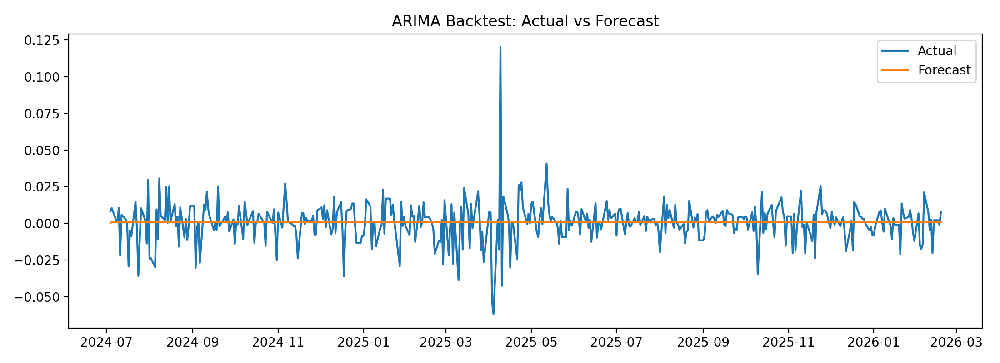
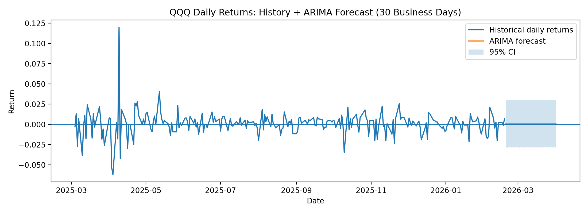
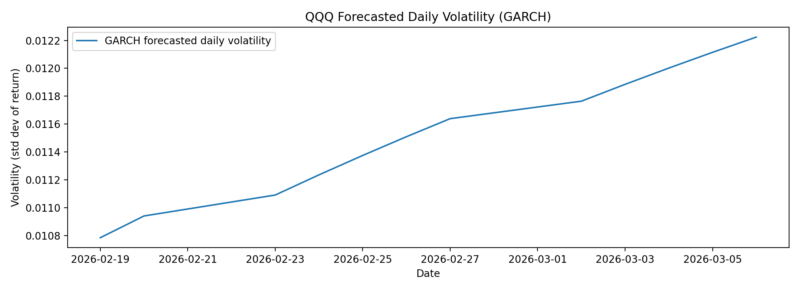

# Margin & Returns Forecasting

This project builds a forward-looking analytics framework to forecast financial returns, model volatility, and simulate margin stability using time series methods.

The goal is to move beyond simple prediction and toward **decision-grade insight** by combining:

- Return forecasting (ARIMA)
- Structural trend modeling (Prophet)
- Volatility modeling (GARCH)

---

## Project Overview

This repository demonstrates how financial performance can be modeled through:

| Model | Purpose |
|-------|--------|
| ARIMA | Short-term return forecasting |
| Prophet | Long-term structural trend forecasting |
| GARCH | Volatility / risk modeling |

Together, these components provide a more realistic view of future performance by capturing:

- Expected returns  
- Uncertainty  
- Instability

---

## Key Capabilities

- Time series forecasting of asset returns
- Volatility modeling using GARCH
- Margin trend simulation
- Out-of-sample backtesting
- Confidence interval visualization

---

## Example Outputs

The notebooks generate:

- ARIMA return forecasts
- Backtested performance vs actual values
- Volatility forecasts (risk outlook)
- Margin trend projections

---

## Project Structure
```text
margin-returns-forecasting/
│
├── src/
│   ├── data_prep.py
│   ├── arima_model.py
│   ├── prophet_model.py
│   ├── volatility_model.py
│   ├── validation.py          # walk-forward, metrics, DM test
│   └── run_validation.py
├── tests/
│
├── notebooks/
│   ├── margin_forecast.ipynb
│   └── returns_forecast.ipynb
│
├── data/
├── outputs/
├── requirements.txt
└── README.md
```
---

## Walk-forward validation

The notebook backtest fits once on 80% of the data and forecasts the rest, so it mostly shows an ARMA forecast decaying to its mean. `src/validation.py` evaluates **one-step-ahead** forecasts instead, re-fit through time on an expanding window so that the forecast for day $t$ uses only data before $t$ (a test asserts there is no look-ahead).

Metrics:

- MAE, RMSE and directional hit rate.
- Out-of-sample $R^2$ against a benchmark (Campbell–Thompson): $R^2_{OS} = 1 - \sum e_t^2 / \sum e_{b,t}^2$, positive when the model beats the benchmark. Here the benchmark is the zero forecast.
- Diebold–Mariano test (Harvey small-sample correction) of equal squared-error accuracy vs the benchmark.
- For volatility: QLIKE loss $\mathrm{RV}/\hat\sigma^2 - \ln(\mathrm{RV}/\hat\sigma^2) - 1$ using squared returns as the realised-variance proxy, plus RMSE of volatility.

Baselines: zero forecast, historical mean, persistence; for volatility a 63-day rolling estimate and RiskMetrics EWMA ($\lambda=0.94$) against GARCH(1,1).

```bash
pip install -r requirements-dev.txt
python -m pytest -q tests            # 14 tests
python -m src.run_validation         # simulated data
python -m src.run_validation QQQ     # real data via yfinance, if reachable
```

### Results

> These numbers come from **simulated** AR(1)-GARCH(1,1) returns (2,500 days, AR coefficient 0.05, seed 42), because market data could not be downloaded when this was generated. The point is the validation methodology; re-run with a ticker for real-data results. Evaluation starts after 750 days and uses every 5th day.

| Model | MAE | RMSE | Hit rate | OOS $R^2$ vs zero | DM p-value |
|---|---|---|---|---|---|
| zero | 0.00828 | 0.01077 | – | 0 | – |
| historical mean | 0.00829 | 0.01077 | 0.497 | -0.0002 | 0.90 |
| persistence | 0.01024 | 0.01344 | 0.549 | -0.559 | 0.00001 |
| AR(1) | 0.00824 | 0.01065 | 0.543 | 0.022 | 0.082 |
| ARMA(2,2) | 0.00831 | 0.01073 | 0.511 | 0.008 | 0.57 |

| Variance model | QLIKE | Vol RMSE (bp) |
|---|---|---|
| rolling 63d | 1.4036 | 68.05 |
| EWMA 0.94 | 1.3364 | 65.84 |
| GARCH(1,1) | 1.3414 | 65.81 |

Reading it: persistence is far worse than predicting zero (it doubles the noise), AR(1) edges out the baselines but not significantly at 5%, and the richer ARMA(2,2) does worse than AR(1) out of sample. For variance, EWMA and GARCH are nearly tied and both beat the rolling window. Full tables are in `outputs/walk_forward_*.csv`.



---

## Sample Outputs

### ARIMA Backtest (Actual vs Forecast)



---

### Future Return Forecast (Next 30 Business Days)



---

### Volatility Forecast (GARCH)



---


